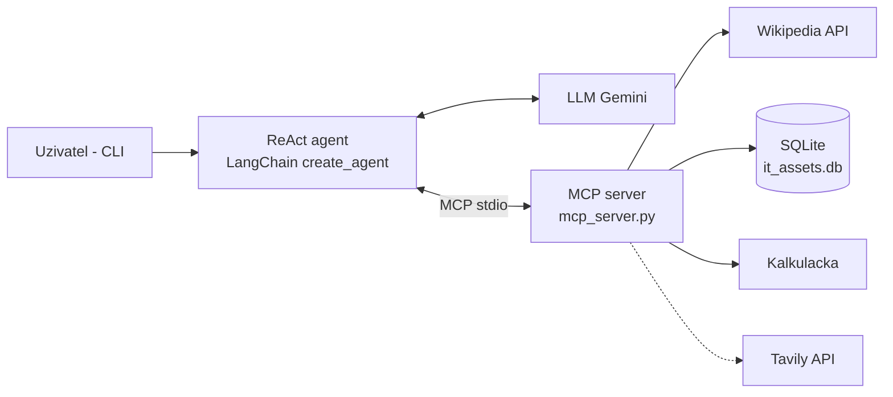

# AI agent s nastroji pres MCP

Ukol ze skoleni **AI agenti – Tvorba agenta s nastroji**.

| Parametr | Volba |
|---|---|
| Typ agenta | **ReAct** (Uvaha -> Akce -> Pozorovani ve smycce) |
| Framework | **LangChain 1.x / LangGraph** (`create_agent`) |
| Nastroje | vlastni **MCP server** (FastMCP) misto framework-specific toolu |
| LLM | Google Gemini (`langchain-google-genai`) |

## Nastroje (MCP server `mcp_server.py`)

| Nastroj | Kategorie | Popis |
|---|---|---|
| `wikipedia_search` | Wikipedia | shrnuti clanku z cs/en Wikipedie |
| `db_schema` | Databaze (SQL) | schema SQLite databaze IT majetku |
| `sql_query` | Databaze (SQL) | read-only SELECT nad tabulkami `users`, `devices` |
| `calculator` | Vypocty | bezpecny vypocet vyrazu (AST, bez `eval`) |
| `web_search` | Vyhledavac | Tavily – nacte se jen pokud je nastaven `TAVILY_API_KEY` |

Databaze obsahuje pouze smyslena ukazkova data (fiktivni osoby a zarizeni).

## Architektura



Proc MCP: nastroje jsou oddelene od frameworku, stejny server lze pripojit
k jinemu agentovi/klientovi (VS Code, Claude Desktop, MCP Inspector) bez zmeny kodu.

## Instalace a spusteni

```bash
git clone https://github.com/xpslana00/ai-agent-mcp.git
cd ai-agent-mcp
python -m venv .venv
# Windows: .venv\Scripts\activate    Linux/macOS: source .venv/bin/activate
pip install -r requirements.txt
cp .env.example .env      # Windows: copy .env.example .env  -> doplnit GOOGLE_API_KEY
python init_db.py         # volitelne, agent DB vytvori sam
python agent.py
```

## Ukazkove dotazy

- `Kolik zarizeni mame podle operacniho systemu?` -> `db_schema`, `sql_query`
- `Kdo pouziva Dell Latitude 5550 a v jakem je oddeleni?` -> SQL JOIN
- `Co je Model Context Protocol?` -> `wikipedia_search`
- `Kolik zarizeni ma Windows 11 a kolik je to procent ze vsech aktivnich?` -> SQL + `calculator`
- `Ktere notebooky maji jeste Windows 10 a kdy konci jeho podpora?` -> SQL + Wikipedia/web

Ukazka vystupu:

```
Ty: Kolik zarizeni mame podle operacniho systemu?
  [akce] db_schema({})
  [pozorovani] -- users CREATE TABLE users ( ...
  [akce] sql_query({'query': 'SELECT os, COUNT(*) FROM devices GROUP BY os'})
  [pozorovani] os | COUNT(*) Android | 1 Ubuntu | 1 Windows 10 | 1 Windows 11 | 5 ...

Agent: Windows 11: 5, Windows 10: 1, macOS: 1, Ubuntu: 1, Android: 1, iOS: 1.
```

## Struktura projektu

```
agent.py          ReAct agent, MCP klient, CLI
mcp_server.py     MCP server s nastroji
init_db.py        vytvoreni ukazkove SQLite databaze
requirements.txt  zavislosti
.env.example      sablona konfigurace (API klice)
.gitignore        vylouceni .env, .venv, data
```

## Bezpecnost

- API klice jen v `.env` (je v `.gitignore`).
- SQL nastroj otevira DB v rezimu read-only a povoluje pouze jeden `SELECT`.
- Kalkulacka nepouziva `eval`, jen whitelist aritmetickych operaci.
